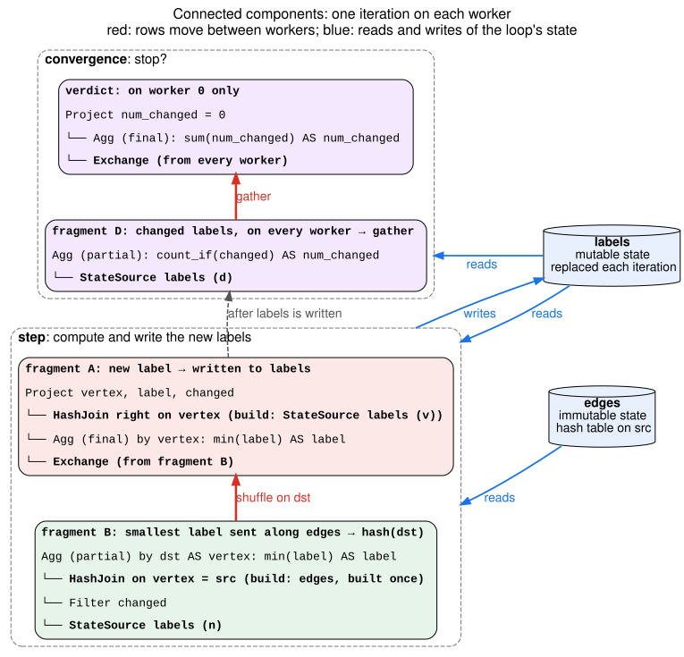

# Fixed Point — Connected Components Walkthrough

*Connected components followed from the logical plan through single-node and
distributed execution to the passes that produce its Velox plan. The loop
node, its invariants and its placement rules are in
[FixedPoint.md](FixedPoint.md); PageRank is in
[FixedPoint-pagerank.md](FixedPoint-pagerank.md).*

**Status:** the logical plan below is built by
`FixedPointTest.connectedComponents`, and optimizer v2 produces the plans
below on one worker and on several.

## One iteration, in SQL

Every vertex starts with its own id as its label. Each iteration lowers every
vertex's label to the smallest label among its in-neighbors. Once no label
changes, the vertices that share a label form a component. Labels flow from
`src` to `dst`, so for undirected components `edges` holds each edge in both
directions.

The state is a table `labels`, one row per vertex:

- `vertex` BIGINT, the state's key
- `label` BIGINT: the smallest vertex id seen so far
- `changed` BOOLEAN: whether the label dropped in the last iteration

The inputs are:

- `vertices`:
  - `vertex` BIGINT
- `edges`:
  - `src` BIGINT
  - `dst` BIGINT

One iteration computes a new `labels` from the old one:

```sql
SELECT v.vertex,
       least(v.label, coalesce(m.label, v.label)) AS label,
       coalesce(m.label < v.label, false) AS changed
FROM labels v                                        -- (A) every vertex's label
LEFT JOIN (SELECT e.dst, min(n.label) AS label      -- (B) smallest label among in-neighbors
           FROM labels n JOIN edges e ON n.vertex = e.src
           WHERE n.changed
           GROUP BY e.dst) m ON v.vertex = m.dst
```

Only vertices whose label changed in the last iteration send it. A vertex
whose label stayed the same already sent that label to its out-neighbors, and
their labels are no larger now, so sending it again changes nothing. Every
vertex starts with `changed` true, so the first iteration sends from all of
them. The result is the same as sending from every vertex, and late
iterations, where few labels still change, do far less work. The optimizer
cannot derive this from the plan, so the plan states it.

The loop stops when this returns true:

```sql
SELECT count_if(d.changed) = 0 FROM labels d        -- (D)
```

The step reads the state twice, as `v` and `n`. The convergence reads the new
state once more, as `d`.

## The logical plan

```
FixedPoint labels  (replace, up to 100 iterations, fail at the bound, key vertex)
├─ anchor:
│    Project vertex, vertex AS label, true AS changed
│    └─ Scan vertices                                     ◀ runs once
├─ step:
│    Project vertex, label, changed
│    └─ Left join  v.vertex = m.dst
│        ├─ State labels AS v                             (A)
│        └─ Aggregate by e.dst: min(n.label) AS label     (B)
│            └─ Join  n.vertex = e.src
│                ├─ Filter n.changed
│                │   └─ State labels AS n
│                └─ Scan edges AS e                       ◀ reads no state
└─ convergence:
     Project num_changed = 0
     └─ Aggregate: count_if(d.changed) AS num_changed     (D)
         └─ State labels AS d
```

The loop returns its state once no label changes. Reaching 100 iterations
first fails the query.

## Single-node execution

Before the loop, the anchor produces the first `labels`, and `edges` is read
once into a hash table keyed on `src`. Each iteration reads `labels` twice,
probes the edges table with the vertices whose label changed, and replaces
`labels`; the
convergence then counts the labels that changed.

## Distributed execution

- **`labels` is partitioned on `vertex`.** Each worker keeps its vertices'
  rows and replaces only those.
- **`edges` is partitioned on `src`,** next to the state, so the join of `n`
  with `edges` runs on each worker.

Rows move between workers in two places each iteration:

1. **(B) produces rows for vertices other workers own.** Each worker computes
   the smallest label it sends to each `dst` and **shuffles** these partial
   minimums on `dst`.
2. **(D) needs one answer.** Each worker counts its changed labels, and the
   counts are **gathered** on worker 0, which decides whether to stop.

The diagram shows the Velox plan, one box per fragment, with data flowing up:



Each fragment reads at most one exchange, so the plan follows the logical
plan directly. Fragment A could also skip its join with the state, as
PageRank's does: fragment B sends each vertex's own row through the shuffle
with the partial minimums, and fragment A aggregates by `vertex`. Here that
only saves work; the plan is valid without it.

## What each pass does

- **Translate** lowers the loop as for PageRank: replace mode, the
  convergence, the bound, and one `WorkingTable` per read of the state.
- **EstimateLeafStats** reports unknown cardinality for the loop and its
  reads, so the step keeps its written join order.
- **PlanPhysical** partitions the loop with the rules it has today: the step
  aggregates, so it is not row-local, and its first join reads the state on
  `vertex`. `edges` is repartitioned on `src`, and the aggregate by `dst` is
  shuffled on `dst`. The convergence is planned with the query's workers and
  split at a gather into per-worker counts and the verdict on worker 0, as
  PlanPhysical plans its own stop condition for a partitioned loop today.
- **Emit** cuts the step at the shuffle into fragments B and A. The join with
  `edges` becomes a `HashTableStateDeclaration` probed by a
  `StateHashJoinNode`, each read of the state becomes its own
  `StateSourceNode`, and the convergence becomes
  `ConvergenceConfig::globalVerdict`.
