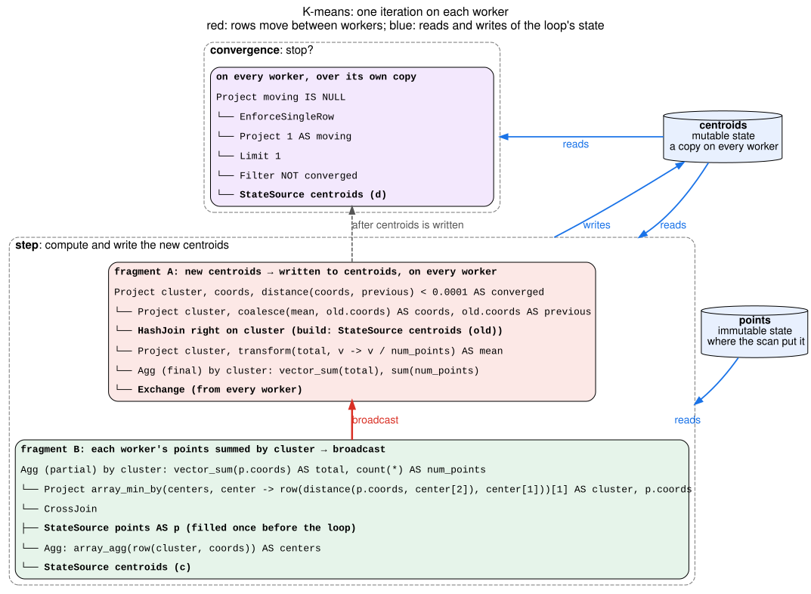

# Fixed Point — K-Means Walkthrough

*K-means followed from the logical plan through single-node and distributed
execution to the passes that produce its Velox plan. The loop node, its
invariants and its placement rules are in [FixedPoint.md](FixedPoint.md);
PageRank is in [FixedPoint-pagerank.md](FixedPoint-pagerank.md).*

**Status:** the logical plan below is built by `FixedPointTest.kMeans`.
Optimizer v2 plans it and runs it on one worker. With several workers it runs
on one task until PlanPhysical can replicate the state on every worker, as
the distributed plan below does.

## One iteration, in SQL

Each iteration assigns every point to its nearest centroid and moves each
centroid to the mean of its points. A centroid with no points stays where it
is. The loop stops once no centroid moves by more than a tolerance.

The state is a table `centroids`, one row per cluster:

- `cluster` BIGINT, the state's key
- `coords` ARRAY(DOUBLE): the centroid's position, one value per
  dimension
- `converged` BOOLEAN: whether the centroid moved by less than the tolerance
  in the last iteration

The inputs are:

- `points`, the points to cluster:
  - `id` BIGINT
  - `coords` ARRAY(DOUBLE): the point's position, one value per
    dimension, such as an embedding vector
- `seeds`, the starting centroids:
  - `cluster` BIGINT
  - `coords` ARRAY(DOUBLE): the starting position

Every point and centroid has the same number of dimensions.
`distance(a, b)` below is shorthand for the squared distance between two
positions:

```sql
array_sum(zip_with(a, b, (u, v) -> (u - v) * (u - v)))
```

One iteration computes new `centroids` from the old ones:

```sql
SELECT cluster, coords, distance(coords, previous) < 0.0001 AS converged
FROM (
  SELECT old.cluster,
         coalesce(new.coords, old.coords) AS coords,
         old.coords AS previous
  FROM centroids old                          -- (A) every centroid's previous position
  LEFT JOIN (                                 -- (B) the mean of each cluster's points
    SELECT cluster,
           transform(total, v -> v / cast(num_points AS DOUBLE)) AS coords
    FROM (
      SELECT cluster, vector_sum(coords) AS total, count(*) AS num_points
      FROM (                                  -- each point's nearest centroid
        SELECT array_min_by(c.centers,
                 center -> row(distance(p.coords, center[2]), center[1]))[1]
                 AS cluster,
               p.coords
        FROM points p
        CROSS JOIN (SELECT array_agg(row(cluster, coords)) AS centers
                    FROM centroids c))
      GROUP BY cluster)) new ON old.cluster = new.cluster
)
```

Each point is one row that computes its distances to all centroids at once,
against one row that holds every centroid. `array_min_by` picks the center
with the smallest distance; pairing the distance with the cluster makes a tie
go to the lowest cluster. Cross joining the points with the
centroid rows and grouping by point would give the same result through k rows
per point and a hash aggregation over all of them. The optimizer cannot turn
one form into the other, so the plan states the cheaper one.

The loop stops when this returns true:

```sql
SELECT (SELECT 1 FROM centroids d WHERE NOT d.converged LIMIT 1) IS NULL  -- (D)
```

The subquery stops reading at the first centroid that still moves. With none,
it returns NULL, and the loop stops.

The step reads the state twice, as `old` and as `c`, the centers. The
convergence reads the new state once more, as `d`.

## The logical plan

```
FixedPoint centroids  (replace, up to 20 iterations, key cluster)
├─ anchor:
│    Project cluster, coords, false AS converged
│    └─ Scan seeds                                         ◀ runs once
├─ step:
│    Project cluster, coords, distance(coords, previous) < 0.0001 AS converged
│    └─ Project old.cluster, coalesce(new.coords, old.coords) AS coords,
│               old.coords AS previous
│        └─ Left join  old.cluster = new.cluster
│            ├─ State centroids AS old                     (A)
│            └─ Project cluster, mean AS coords        (B)
│                └─ Aggregate by cluster: vector_sum(p.coords), count(*)
│                    └─ Project nearest of centers AS cluster, p.coords
│                        └─ Cross join
│                            ├─ Scan points AS p           ◀ reads no state
│                            └─ Aggregate: array_agg(row(cluster, coords)) AS centers
│                                └─ State centroids AS c
└─ convergence:
     Project (subquery) IS NULL                            (D)
     └─ Values: one row
     subquery:
       Limit 1
       └─ Filter NOT d.converged
           └─ State centroids AS d
```

The loop returns its state once every centroid has converged, or after 20
iterations, whichever comes first.

## Single-node execution

Before the loop, the anchor produces the first `centroids`, and `points` is
read once into memory. Each iteration gathers the centroids into one row,
computes each point's distance to every centroid, assigns each point to its
nearest, averages each cluster's
points, and replaces `centroids`; the convergence then counts the centroids
that still move.

## Distributed execution

The state is small, one row per cluster, and every point needs all of it. The
points are large. So:

- **`points` stays where it was scanned,** in memory on the worker that read
  it. Each point is handled on its own, so any worker can hold it.
- **`centroids` is replicated on every worker.** The anchor's rows are
  broadcast, and every worker ends each iteration with the same new state.
- **Each cluster has an owner,** the worker its `cluster` hashes to. The owner
  computes the cluster's new centroid.

Rows move between workers twice each iteration:

1. **Each worker's partial sums go to the owners.** Each worker sums the
   points it holds by cluster and **shuffles** the partial sums on `cluster`:
   it sends at most one row per cluster.
2. **Each new centroid goes to every worker.** The owner computes the
   cluster's mean and **broadcasts** it, so every worker receives each new
   centroid once.

The diagram shows the Velox plan, one box per fragment, with data flowing up:



Worker 0 decides when to stop: it evaluates the convergence over its replica of
the state and sends the answer to the other workers, so every worker stops on
the same iteration. When the loop ends, worker 0 emits its replica as the
result. Nothing relies on the replicas being identical: workers can compute the
same floating-point expression differently, for example on machines whose
CPUs take different SIMD code paths.

Broadcasting the partial sums instead, and finishing the sums on every
worker, saves one exchange but sends every worker's sums to every worker:
with 100 workers and 40,000 centroids of 256 dimensions, about 400 GB per
iteration instead of about 8 GB.

The order of the fragments follows from where the state lives. The first
fragment of an iteration reads the state, and the last one writes it. With the
state replicated on every worker, the iteration starts with the step that
needs every centroid, assigning the points, and ends once every worker has
every new centroid. A centroid with no points keeps its coordinates: fragment
A joins the new centroids with the old ones on every worker, after the
broadcast.

## What each pass does

- **Translate** lowers the loop as for PageRank: replace mode, the
  convergence, the bound, and one `WorkingTable` per read of the state.
- **EstimateLeafStats** reports unknown cardinality for the loop and its
  reads, so the step keeps its written join order.
- **PlanPhysical** needs a third placement next to independent loops and one
  partitioned loop: the state replicated on every worker. It plans the step
  both ways and keeps the one whose exchanges move fewer bytes per iteration.
  A partitioned loop does not plan for k-means: every point needs every
  centroid.
  - The anchor is broadcast, and the `WorkingTable` claims that every worker
    holds all of the state.
  - The step's input that reads no state, `points`, stays where its scan
    placed it.
  - The aggregation by `cluster` is split into partial sums, a shuffle on
    `cluster`, and the final sums, and its result is broadcast.
  - The left join with the old centroids runs after the broadcast, on every
    worker, with the broadcast rows on its probe side.
  - The convergence is planned as a local plan over the state, which worker 0
    runs.
  - The loop's output comes from worker 0 only.

  A replicated state plans when the state's size and the size of the broadcast means fit
  `broadcast_size_limit`. The state keeps the anchor's row count: the step
  left-joins the old centroids with an aggregation by `cluster`, which is
  unique on the join key. The means have one row per distinct value of
  `array_min_by(...)[1]`, at most one per centroid, which needs statistics
  for the values inside arrays and rows.
- **Emit** cuts the step at the shuffle and the broadcast into fragments C, B
  and A. `points` becomes a `VectorStateDeclaration` filled once before the
  loop, and each read of the state becomes its own `StateSourceNode`. The
  convergence becomes a verdict that worker 0 computes over its own state and
  sends to the other workers; Velox needs to allow a verdict with no gather in
  front of it. The loop's output needs a `FixedPointNode` option to emit the
  state on worker 0 only.
