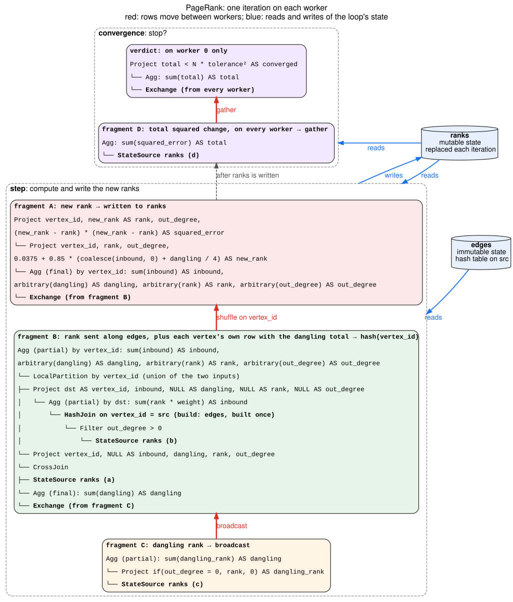

# Fixed Point — PageRank Walkthrough

*One iterative algorithm, PageRank, followed from the logical plan through
single-node and distributed execution to the passes that produce its Velox
plan. The loop node, its invariants and its placement rules are in
[FixedPoint.md](FixedPoint.md).*

**Status:** the logical plan below is built by `FixedPointTest.pageRank`.
Optimizer v2 plans it and runs it on one worker. With several workers it runs
on one task until PlanPhysical produces one of the distributed plans below;
the pieces that takes are marked as follow-ups in
[What each pass does](#what-each-pass-does).

## One iteration, in SQL

The state is a table `ranks`, one row per vertex:

- `vertex_id` BIGINT
- `rank` DOUBLE
- `out_degree` BIGINT: number of out-edges, from the `vertices` input
- `squared_error` DOUBLE: the rank's squared change in the last iteration

The inputs are:

- `vertices`:
  - `vertex_id` BIGINT
  - `out_degree` BIGINT
- `edges`:
  - `src` BIGINT
  - `dst` BIGINT
  - `weight` DOUBLE

The example has N = 4 vertices, damping factor 0.85 and tolerance 1e-4.

One iteration computes a new `ranks` from the old one:

```sql
SELECT vertex_id, rank, out_degree,
       (rank - previous) * (rank - previous) AS squared_error
FROM (
  SELECT a.vertex_id,
         0.0375 + 0.85 * (coalesce(i.inbound, 0.0) + g.dangling / 4.0) AS rank,
         a.out_degree,
         a.rank AS previous
  FROM ranks a                                            -- (A) every vertex's previous rank
  LEFT JOIN (SELECT e.dst, sum(b.rank * e.weight) AS inbound -- (B) rank arriving along edges
             FROM ranks b JOIN edges e ON b.vertex_id = e.src
             WHERE b.out_degree > 0
             GROUP BY e.dst) i ON a.vertex_id = i.dst
  CROSS JOIN (SELECT sum(if(c.out_degree = 0, c.rank, 0.0)) AS dangling
              FROM ranks c) g                             -- (C) rank held by vertices with no out-edges
)
```

The loop stops when this returns true:

```sql
SELECT coalesce(sum(d.squared_error), 0.0) < 4e-8 FROM ranks d  -- (D)
```

0.0375 is (1 - 0.85) / N, and 4e-8 is N times the squared tolerance. The step
reads the state three times, as `a`, `b` and `c`, and produces a new state.
The convergence reads the new state once more, as `d`.

## The logical plan

`State ranks` is a `RecursiveReferenceNode`, a read of the loop's state.

```
FixedPoint ranks  (replace, up to 100 iterations, key vertex_id)
├─ anchor:
│    Project vertex_id, 0.25 AS rank, out_degree, 0.0 AS squared_error
│    └─ Scan vertices                                     ◀ runs once
├─ step:
│    Project vertex_id, rank, out_degree, squared_error
│    └─ Cross join
│        ├─ Left join  a.vertex_id = i.dst
│        │   ├─ State ranks AS a                          (A)
│        │   └─ Aggregate by e.dst: sum(b.rank * e.weight) AS inbound  (B)
│        │       └─ Join  b.vertex_id = e.src
│        │           ├─ Filter b.out_degree > 0
│        │           │   └─ State ranks AS b
│        │           └─ Scan edges AS e                   ◀ reads no state
│        └─ Aggregate: sum(if(c.out_degree = 0, c.rank, 0.0)) AS dangling  (C)
│            └─ State ranks AS c
└─ convergence:
     Project coalesce(total, 0.0) < 4e-8
     └─ Aggregate: sum(d.squared_error) AS total          (D)
         └─ State ranks AS d
```

The loop returns its state when the convergence is true, or after 100
iterations, whichever comes first.

## Single-node execution

Before the loop:

1. **The anchor runs once** and produces the first `ranks`, with every rank
   at 1/N.
2. **`edges` is read once** into a hash table keyed on `src`. Every iteration
   probes it and none changes it.

Each iteration:

3. **The step reads `ranks` three times**, as `a`, `b` and `c`, probes the
   edges table, and computes a new `ranks` that replaces the old one.
4. **The convergence reads the new `ranks`** as `d`. If the total squared
   change is below 4e-8, the loop stops; otherwise the next iteration starts.

The state lives in memory on each worker (Velox `PersistentState`). A read of
the state is a `StateSourceNode` that emits the batches in memory, so reading
it three times in one iteration scans the same batches three times.

## Distributed execution

A small graph's state fits a broadcast, and replicating the state on every
worker is cheaper; see [A state that fits a broadcast](#a-state-that-fits-a-broadcast).
For a larger graph, each worker owns a subset of the vertices and holds the
data about them:

- **`ranks` is partitioned on `vertex_id`.** Each worker keeps its vertices'
  rows and replaces only those. A vertex's new rank is computed by the worker
  that owns it, so the state stays in place across iterations.
- **`edges` is partitioned on `src`,** the same key, so each worker holds the
  out-edges of the vertices it owns, and the join of `b` with `edges` runs
  on each worker.
- **`vertices` is repartitioned on `vertex_id`** once, so the anchor seeds
  each worker's slice.

Rows move between workers in three places each iteration:

1. **(C) needs a total over all workers.** Each worker sums its own vertices'
   dangling rank and **broadcasts** the partial sum; every worker adds up the
   partials and gets the same total.
2. **(B) produces rows for vertices other workers own.** A worker's edges lead
   from its vertices to any vertex, so it computes partial sums by `dst` and
   **shuffles** them on `dst`. Each worker receives the sums for its own
   vertices.
3. **(D) needs one answer.** Each worker sums the squared change over its
   slice, and the partial sums are **gathered** on worker 0, which decides
   whether to stop and shares the verdict. Every worker stops on the same
   iteration.

The diagram shows the Velox plan, one box per fragment, with data flowing up:



Planned directly from the logical plan, fragment A would compute the new
rank where the sums from (B) arrive, and would read two exchanges: the
shuffle with those sums and the broadcast with the total from (C).

```
fragment A, read directly from the logical plan
CrossJoin
├── Left join  a.vertex_id = vertex_id
│   ├── StateSource ranks (a)
│   └── Agg (final) by vertex_id: sum(inbound) AS inbound
│       └── Exchange (shuffle from fragment B)
└── Agg (final): sum(dangling) AS dangling
    └── Exchange (broadcast from fragment C)
```

A body fragment reads at most one exchange, so the plan moves the broadcast
to fragment B, which reads only the state and the edges table. Fragment B
cross joins its
slice of the state, read `a`, with the total, and sends those rows through
the shuffle together with the edge partial sums. Each of those rows is keyed
on its own vertex, so it stays on the worker that owns the vertex. Fragment
A then aggregates by `vertex_id`: the edge partial sums add up to `inbound`,
and the vertex's own row supplies `rank`, `out_degree` and the total. The
state has one row per vertex, so every vertex appears exactly once, with or
without in-edges, and fragment A needs no join with the state.

### A state that fits a broadcast

When the ranks fit `broadcast_size_limit`, the state is replicated on every
worker, as in k-means ([FixedPoint-kmeans.md](FixedPoint-kmeans.md)):

- **`edges` stays where it was scanned.** Each worker joins its replica of the
  ranks with its share of the edges and **shuffles** the partial sums by
  `dst`; each sum's owner adds them up and **broadcasts** the result.
- **The dangling total needs no exchange.** Each worker sums it over its own
  replica of the state.
- **Worker 0 decides when to stop** over its replica and sends the verdict to the
  other workers, and emits the result.

Each body fragment reads one exchange, so this plan needs no rewrite.
PlanPhysical compares it with the partitioned plan by the bytes each moves
per iteration.

## What each pass does

The plan above follows from the rules in
[FixedPoint.md](FixedPoint.md#what-each-pass-does-with-a-fixed-point), with
the additions marked as follow-ups.

- **Translate** lowers the `FixedPointNode` to a `FixedPoint` that replaces
  its state, with its convergence and its bound that returns the current
  state. Each of the four `RecursiveReferenceNode`s becomes its own
  `WorkingTable`, with its own columns.
- **EstimateLeafStats** reports unknown cardinality for the loop and its
  reads, so the step keeps its written join order.
- **PlanPhysical** needs to replicate the state on every worker for a state
  that fits a broadcast (follow-up *A state replicated on every worker*), and
  for a larger state needs to partition the loop: the step aggregates, so it
  is not row-local. It looks for the keys to partition on along the last input of
  the step that reads the state, here the dangling total, which has none, so
  today the loop runs on one task. The distributed plan needs the state
  partitioned on `vertex_id`, the key of the step's first join, with the anchor
  repartitioned on it. Then:
  - `edges` is partitioned on `src`, next to the state, so the join with it
    stays on each worker (follow-up *A step input placed next to the state*).
  - The aggregate by `dst` is shuffled on `vertex_id`.
  - The global aggregate (C) is split into partial sums and a broadcast.
  - `a` is cross joined with the total and sent through the same shuffle,
    and the left join of `a` with (B) becomes an aggregation by `vertex_id`
    over both. This relies on the state having one row per `vertex_id`,
    which the logical plan declares as the state's key (follow-up *A
    broadcast value and a shuffle in one fragment*).
  - The convergence is split at a gather into per-worker partial sums and the
    verdict on worker 0.
- **Emit** cuts the step at each exchange into fragments C, B and A. The join
  with `edges` reads no state, so its build side becomes a
  `HashTableStateDeclaration`, built once and probed by a `StateHashJoinNode`.
  Each read of the state becomes its own `StateSourceNode`. The convergence
  becomes `ConvergenceConfig::globalVerdict`: fragment D runs on every worker
  and the verdict plan on worker 0.
